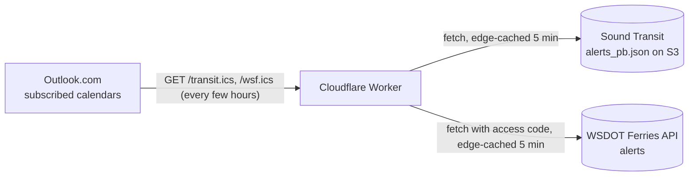

# transit-ics

Sound Transit and Washington State Ferries service alerts as calendars you
subscribe to in Outlook.

A single Cloudflare Worker (no dependencies, no storage, no schedule). Each time
your calendar app asks for a feed, the Worker reads the agency's alerts, keeps
the routes you asked for, and returns iCalendar. Alerts the agency clears
disappear on the next refresh.

| Feed | Source | Default routes |
|---|---|---|
| `/transit.ics` | Sound Transit's public GTFS-Realtime alerts feed | 2 Line |
| `/wsf.ics` | WSDOT Ferries API alerts (needs a free access code) | Seattle/Bainbridge, Seattle/Bremerton, Edmonds/Kingston |



## How alerts become events

### Sound Transit (`/transit.ics`)

| Alert shape | Calendar event |
|---|---|
| Up to 24 hours (e.g. a concert, 8:00–11:30 p.m.) | Timed event |
| Longer than 24 hours (e.g. a weekend closure) | All-day banner across those dates |
| No end time ("until further notice") | All-day banner from start through today, prefixed `[Ongoing]` |

- Ends before 4 a.m. count as the previous service day, so "until end of service Sunday" (about 2:30 a.m. Monday in the feed) doesn't spill onto Monday.
- Events are marked **Free**, not Busy.
- The description holds the full alert text and the Sound Transit link.

### Washington State Ferries (`/wsf.ics`)

WSF alerts have no start or end time, only the date they were published. So
each alert is an all-day banner, prefixed `⛴ [Ongoing]`, from its publish date
through today, for as long as WSF lists it. A notice published on Aug 30 and
still listed on Oct 12 shows as a banner from Aug 30 to Oct 12; when WSF
removes it, it disappears. See [ADR 6](docs/adr/0006-wsf-event-timing.md).

- Any end date is only in the text ("through Oct. 12"), so read the description.
- Events are marked **Free**, not Busy.
- The description holds the bulletin as plain text and a link to [WSF's travel alerts page](https://wsdot.com/ferries/schedule/bulletin.aspx).

## Routes

### Sound Transit

`/transit.ics` defaults to the 2 Line. Add `?routes=` for others (comma-separated):

| Line | route id |
|---|---|
| 2 Line | `2LINE` |
| 1 Line | `100479` |
| Sounder N/S | `SNDR_EV`, `SNDR_TL` (check feed) |

Example: `https://transit-ics.<subdomain>.workers.dev/transit.ics?routes=2LINE,100479`

Route ids are 1–32 letters, digits or `_`, at most 10 per request; anything else returns 400.

### Washington State Ferries

`/wsf.ics` defaults to the routes in `WSF_ROUTES` in [`wrangler.toml`](wrangler.toml)
(**5, 3, 6**). Add `?routes=` for others (comma-separated). Ids come from the
WSDOT Ferries API's routes operation (checked 2026-10-12):

| Route | route id |
|---|---|
| Pt. Defiance / Tahlequah | `1` |
| Seattle / Bremerton (default) | `3` |
| Seattle / Bainbridge Island (default) | `5` |
| Edmonds / Kingston (default) | `6` |
| Mukilteo / Clinton | `7` |
| Port Townsend / Coupeville | `8` |
| Anacortes / San Juan Islands | `9` |
| Fauntleroy (West Seattle) / Southworth | `13` |
| Fauntleroy (West Seattle) / Vashon | `14` |
| Southworth / Vashon | `15` |

Example: `https://transit-ics.<subdomain>.workers.dev/wsf.ics?routes=5,9`

Route ids are 1–4 digits, at most 10 per request; anything else returns 400.

Notices WSF flags as affecting **all routes** are included by default. Add
`?allroutes=0` to leave them out (`?allroutes=1` forces them in). The default
comes from `WSF_INCLUDE_ALL_ROUTES` in `wrangler.toml`.

## Cost

$0 on the Workers Free plan. That plan allows 100,000 requests a day and
10 ms CPU per request. These feeds get a few requests a day and use about 1 ms
each. They use no GitHub Actions minutes. The WSDOT access code is free.

## WSDOT access code

`/wsf.ics` needs a WSDOT Traveler API access code. It is a **secret**: anyone
who has it can use the WSDOT API under your registration. See
[ADR 7](docs/adr/0007-wsdot-access-code-secret.md).

1. Register your email at <https://wsdot.wa.gov/traffic/api/> to get a code.
2. Store it in Cloudflare (prompts for the value; nothing lands in the repo):

   ```powershell
   npx wrangler secret put WSF_API_ACCESS_CODE
   ```

3. For local runs, keep it **outside** this repo, so no tool working in the repo
   can read or commit it:

   ```powershell
   New-Item -ItemType Directory -Force "$env:USERPROFILE\.secrets"
   notepad "$env:USERPROFILE\.secrets\transit-ics.dev.vars"   # one line: WSF_API_ACCESS_CODE=<your code>
   ```

   `npm run dev` loads it from there. `npm test` reads it on purpose and fails
   if the code appears in any file git could commit.

   Use `npm run dev`, not plain `npx wrangler dev`: plain `wrangler dev` records
   each upstream URL, access code included, in a local trace database under
   `.wrangler/`. The script turns that off and keeps wrangler's local state
   outside the repo.

Never put the code in `wrangler.toml`, a `.env` or `.dev.vars` in the repo, an
issue, or a log.

## Deploy (PowerShell)

The feeds are served at `https://transit-ics.<subdomain>.workers.dev/transit.ics`
and `/wsf.ics`. The real subdomain is deliberately kept out of this repo,
because anyone who knows it could use up the free plan's daily request limit.
For setup, updates, rollback, troubleshooting and hostname handling, see the
[Cloudflare runbook](docs/runbook-cloudflare.md). Quick version:

`wrangler dev` runs the Worker locally in `workerd`, Cloudflare's runtime. It
works on Windows x64. `workerd` has no Windows-ARM64 build, so on an ARM64
laptop use WSL (Ubuntu) for `wrangler dev`, or skip it. `wrangler deploy` only
uploads code and does not need `workerd`.

Run these one at a time (PowerShell 7+; `&&` stops at the first failure):

```powershell
cd transit-ics
npm install                          # local only; nothing installed globally
npm run dev                          # optional: http://localhost:8787/transit.ics and /wsf.ics against the live feeds
npx wrangler login                   # opens browser, one-time
npm test && npx wrangler deploy      # tests offline first; prints https://transit-ics.<subdomain>.workers.dev
```

Then open `https://transit-ics.<subdomain>.workers.dev/transit.ics` in a browser.
It should download a small `.ics` file.

## Subscribe in Outlook.com

1. Go to Outlook.com, then Calendar, then **Add calendar**, then **Subscribe from web**.
2. Paste the `/transit.ics` URL (or `/wsf.ics`).
3. Name it (**Transit** or **Ferries**), pick a color, and click Import.

The new calendar also appears in the Outlook apps on Windows and Android.
Family members can subscribe to the same URL.

Outlook.com decides how often to re-fetch, typically every few hours. The
feed's `REFRESH-INTERVAL` hint of 1 hour is advisory. For same-hour
disruptions, keep the email/SMS alerts.

## Source data

- Sound Transit feed: <https://s3.amazonaws.com/st-service-alerts-prod/alerts_pb.json> (GTFS-RT Alerts, JSON form, no key)
- Sound Transit terms: [Open Transit Data](https://www.soundtransit.org/help-contacts/business-information/open-transit-data-otd/otd-downloads)
- WSF feed: `https://www.wsdot.wa.gov/Ferries/API/Schedule/rest/alerts` ([documentation](https://www.wsdot.wa.gov/ferries/api/schedule/documentation/index.html)), JSON via `Accept: application/json`, access code required
- `test/fixture-2026-10-08.json` is a trimmed real Sound Transit snapshot, and `test/fixture-wsf-2026-10-12.json` a real WSF one, used by the tests.

## License

[MIT](LICENSE)
